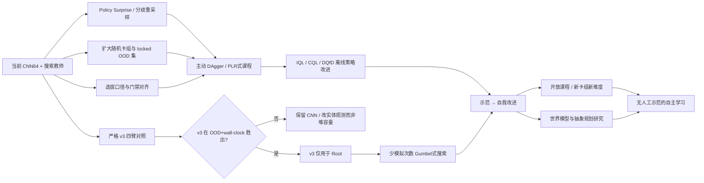

# 植物大战僵尸策略学生网络与搜索教师：Q1–Q7 一手文献调研报告

## Executive Summary

本报告完整阅读了任务书及附件中的实验历史、决策备忘、学生网络结构与上一轮文献综述，并以论文原文、官方技术文档和官方代码为主重新核验。核心结论是：**当前没有一手证据证明在约 1000万–3000万条行为克隆样本下，实体 Transformer 必然比 CNN 更数据高效，也不存在可信的通用“反超样本量”**；因此 v3 应由项目自身的等参数、等训练步数大规模实验裁决。现有证据更支持继续使用共享网络而非地形 MoE，调整模型选拔指标而非贸然重采样历史数据，并把“教师搜索与学生策略的分歧”用于采样优先级。陌生卡组泛化的主要瓶颈更像是**训练配置多样性与教师自身覆盖不足**，而非单纯模型容量。中长期最值得投入的是离线强化学习、少模拟次数策略改进、主动 DAgger、组合泛化表征及严格的 OOD 评估体系。

## 一页结论、项目证据与检索方法

### 一页结论

| 问题 | 结论与建议 | 最关键依据 | 与项目相似度 | 置信度 |
|---|---|---|---|---|
| **Q1 实体/Transformer vs CNN** | **不能从现有文献推出“1000万–3000万样本后注意力反超 CNN”。** 继续做 v3，但必须与 CNN64 和等参数 CNN 做等数据、等优化预算对照；优先限定在老师根节点。 | AlphaStar证明实体 Transformer+pointer 在复杂结构化动作空间可行；Tuyls 等证明 IL 随数据/算力平滑缩放，但没有 Transformer-vs-CNN 同规模交叉实验。 citeturn277446search0turn138006academia2 | 中 | **高**（对“证据不足”的判断）；中（v3最终效果） |
| **Q2 MoE/条件化** | **现在不要上地形 MoE。** 文献说明 Soft MoE 可改善 RL 的容量扩展，但并没有证明它能解决“未见卡组 OOD”；CARE 等支持低容量条件化/共享表征，而项目自己的专家实验已经直接显示泛化变坏。 | Soft MoE、CARE；项目 E3 专家 OOD -4～-20pp。 citeturn277446search7 | 中 | **高** |
| **Q3 平均 vs 最差组** | 不建议从“平均胜率”直接切换成纯 `min terrain`；建议**约束式模型选择**：先要求各地形下置信界不过线，再在可行候选中优化总体指标。 | Group DRO 改善 worst-group 但需正则；DomainBed 强调模型选择规则本身是算法的一部分；AlphaZero/Go 系工程也不会用单一最差样本决定所有升级。 citeturn138006academia1 | 高 | **高** |
| **Q4 教师–学生分歧课程** | **值得立即试。** 最简单是用 `KL(search target || student prior)` 或 teacher/student top-1 disagreement 给现有样本加优先级，同时保留约 50% 均匀采样底座。 | KataGo Policy Surprise Weighting 直接按搜索目标相对 prior 的 KL 提高样本频率；PLR、SafeDAgger 同方向支持。 citeturn723842search2turn277446academia8 | **高** | **高** |
| **Q5 未见卡组泛化** | 最优先增加**卡组/组合多样性**，不是先继续加宽；同时给实体/卡牌保留可组合属性表示。必须先提高老师在未知卡组上的能力，否则纯 BC 的上限受老师约束。 | Cardsformer 对未训练卡牌显式泛化；Procgen 表明配置多样性对泛化极关键。 citeturn157915search1 | 高 | **高** |
| **Q6 二手说法核查** | 多条需要修正：AlphaStar 139M 可核实；“AlphaZero 回放窗 50万局”**错误归因**，AlphaZero 原文未给出该值；AlphaGo 57%/24.2% 与 3ms/2μs 可直接核实；KataGo surprise weighting 可核实，但不存在一个永恒固定的回放窗口。 | 原论文/官方仓库。 citeturn723842search7turn140031search28turn723842search2 | 高 | **高** |
| **Q7 长期路线** | 近期：v3严格对照、分歧重采样、OOD 数据扩展、选拔口径对齐；半年内：IQL/CQL/DQfD、少模拟次数策略改进；长期：自我改进、开放课程、世界模型作为研究支线而非当前主线。 | IQL、CQL、DQfD、Gumbel MuZero 等。 citeturn157915academia2turn157915academia3turn157915academia0 | 中高 | **中高** |

### 附件中的项目事实如何影响判断

本报告把附件中的结果视为**项目内直接证据**，优先级高于任务不完全匹配的外部论文。尤其重要的是：CNN64 已有约 2300 万 `(state, teacher action)` 行；CNN128 在陌生卡组及夜间退化；五地形专家只有轻微本域增益却严重伤害陌生卡组；随机卡组仅约占数据 0.5%；旧历史 DAgger 数据约占六成；教师本身在 54 套陌生卡组上的胜率只有 14.6%。这些事实意味着项目的主要矛盾并不像“网络容量不够”那么简单，而更接近**分布覆盖、结构归纳偏置、教师质量和选拔目标不一致**。

附件还提供了一个特别有价值的负结果：进一步控制训练曝光量后，地形专家的优势大幅缩小，说明早期“专家更擅长本地形”的一部分优势实际上来自重复曝光，而不是模块化本身。这使得外部 MoE 文献必须以更高门槛才能推翻本地证据。

### 数据库与检索策略

本轮主要检索 **arXiv、PMLR、OpenReview、Nature/Google DeepMind 官方页面与原论文 PDF、AAAI/ICLR/AAMAS/ECAI 论文集、作者或项目官方 GitHub**。检索时间截至 **2026-10-30**。优先范围为 2016–2026，Q1/Q2/Q7 尤其优先 2022–2026；经典 AlphaGo、DAgger 系工作因与系统设计高度相关而保留。

核心检索式包括：`entity transformer vs CNN behavior cloning data efficiency`、`scaling laws imitation learning NetHack`、`mixture of experts reinforcement learning out of distribution`、`FiLM multi-task RL generalization`、`group DRO model selection domain generalization`、`teacher student disagreement DAgger active query`、`policy surprise weighting KataGo`、`unseen cards Hearthstone generalization`、`deck generalization card game RL`、`offline RL demonstrations IQL CQL DQfD`、`few simulations policy improvement Gumbel MuZero`。筛选时要求：优先原论文或官方实现；必须能还原实验设置和数字；与 PvZ 的状态结构、动作空间、搜索教师、OOD 卡组或 CPU 推理约束至少有一项实质对应。二手博客只用于发现关键词，不作为关键结论的依据。

## Q1–Q2：网络结构、数据效率与条件化

### Q1：约 1000万–3000万样本下，实体 / Transformer 相对 CNN 的数据效率如何？

#### 结论要点

**任务书提出的关键问题目前在公开一手文献中仍没有直接答案：找不到一个与本项目足够接近、在约 10M–30M 行行为克隆数据上，把实体/集合 Transformer 与 CNN 做严格同数据、同参数或同算力对照，并给出“注意力在多少数据后反超”的实验。** 因而不能把 ViT、语言模型或 AlphaStar 的成功外推为“2300 万行已经足够让 Transformer 赢”。

最接近的两类证据分别说明两件不同的事：AlphaStar 说明实体 Transformer、关系式处理和 pointer/autoregressive action heads 很适合**结构化实体状态与组合动作**；Tuyls 等说明游戏行为克隆确实存在可预测的规模律，增加模型、数据和训练算力能持续改善 IL。但后者在 Atari 使用 CNN、在 NetHack 使用递归结构，并没有给出实体 Transformer 与 CNN 的直接交叉曲线。 citeturn277446search0turn138006academia2

#### 关键文献与数字

| 文献 | 设置与关键数字 | 对本项目的启示 | 相似度 |
|---|---|---|---|
| **Vinyals et al., 2019, AlphaStar** | 原始单位列表经 Transformer torso，之后接 LSTM、autoregressive policy 与 pointer network；先从人类 replay 做监督学习，再进入 league RL。官方说明明确给出这一结构。 citeturn277446search0 | “实体 token + pointer”并非未经验证的异想天开，特别适合可变实体和结构化目标选择。 | **中**：状态结构像，但数据、算力和 RL 规模远大于 PvZ |
| **Tuyls et al., 2023, Scaling Laws for Imitation Learning** | Atari 与 NetHack 的 IL loss/return 随训练 FLOPs 呈平滑 scaling；论文最终训练的 NetHack 模型在预测尺度下达到此前神经方法约 1.5× 表现。 citeturn138006academia2 | 2300万行并不意味着 IL 已饱和；但论文没有证明 attention 比 CNN 更早/更晚进入有效区间。 | **中** |
| **AlphaGo, 2016** | 30M 围棋局面训练 13 层策略 CNN；完整特征 57.0% held-out move accuracy。更宽策略网络准确率有所提高但推理成本明显增加。 citeturn140031search28turn140031search30 | 30M 数量级本身并不要求 Transformer；强空间局部结构下 CNN 可非常有效。 | **中** |
| **Procgen** | 程序化关卡研究表明，仅训练少数固定配置容易产生明显 train-test 泛化差距；许多环境需要数百至数千不同关卡才能形成稳定泛化。 | 对本项目而言，“行数”不能替代“独立配置数”。数千万行集中在少量卡组，信息多样性可能远小于行数显示的规模。 | **中高** |

AlphaStar 还有一个容易被误用的事实：其完整 agent 有约 **139M weights**，但论文同时指出推理时只需要其中约 **55M**；这完全不是一个“小模型数据效率”实验。它只能证明实体式表示能够支撑顶级复杂策略，不能证明 18 万参数 CNN 在本项目数据量下已经应该被 Transformer 替代。 citeturn277446search0

#### 与附件实验合并后的判断

项目自己的早期实体注意力实验比公开文献更接近目标任务。在更详细的附件记录中，该实验仅有约 152 局、单 seed，并且旧状态格式和实现都不完整；CNN64 的 unseen full-action accuracy 约 91.2%，等参数 CNN 约 90.6%，实体注意力约 84.7%，其中最明显的问题发生在“种还是等”这个高层决策头。这个负结果**不能淘汰 v3**，但说明小数据时结构归纳偏置的重要性非常高。

因此 v3 实验应回答的是项目自己的“交叉点”而非寻找文献给出一个不存在的统一数字。建议四臂同时训练：

`CNN64 incumbent / 等参数 CNN / v3-128×2 / v3 去关系偏置消融`

固定同一训练集快照、同一优化步数和至少 2–3 seeds。主要指标不是训练 CE，而应是**陌生卡组胜率、五地形胜率、教师根搜索最终胜率，以及 wall-clock games/hour**。由于根节点与 rollout 网络调用约为 1:132，而 v3 计划只占根调用，结构上类似 AlphaGo 将昂贵强策略和极便宜 rollout policy 分工的思想；AlphaGo 的强 SL policy 为 57.0% 准确率、约 3 ms，而快速 rollout policy 只有 24.2% 准确率但约 2 μs。 citeturn140031search28

**置信度：高**，但这里“高”指的是“公开文献不足以给出反超样本量”这一结论；对 v3 本身是否胜出只能给**中等置信度**。

**关键引用：** Vinyals et al. (2019), *Grandmaster level in StarCraft II using multi-agent reinforcement learning*, Nature, DOI [10.1038/s41586-019-1724-z](https://doi.org/10.1038/s41586-019-1724-z)；Tuyls et al. (2023), *Scaling Laws for Imitation Learning in Single-Agent Games*, [arXiv:2307.09423](https://arxiv.org/abs/2307.09423)；Silver et al. (2016), *Mastering the game of Go with deep neural networks and tree search*, Nature, DOI [10.1038/nature16961](https://doi.org/10.1038/nature16961)。 citeturn138006academia2turn140031search28

### Q2：MoE 与 FiLM/任务条件化对 OOD 是帮还是伤？

#### 结论要点

**MoE 不是“泛化药方”。** Obando-Ceron 等的 Soft MoE 结果很重要：在 Atari RL 中，单纯增加 dense 网络容量有时反而使最终性能下降，而 Soft MoE 能把参数容量扩展得更有效；但这些主要是训练任务内的 RL 结果，并没有回答“对完全未见卡组是否更好”。因此，它不能推翻项目 E3 中“地形专家对陌生卡组下降 4–20pp”的直接证据。

CARE 则更接近一个适合项目的方向：它不是把每个任务完全隔离，而是由任务上下文驱动一组共享 encoder 的组合，在 Meta-World 50 个任务上研究多任务迁移及 unseen environment generalization。论文明确把模型描述为 context encoder 加 mixture of encoders，并专门包含 zero-shot unseen-environment 实验。 citeturn277446search7turn277446search9

#### 文献比较

| 方法 | 核心设计 | OOD证据 | 对 PvZ 判断 |
|---|---|---|---|
| **Soft MoE, Obando-Ceron et al.** | Dense 网络中的模块替换为软路由专家，所有 token 对专家有连续混合 | 强项主要是 Atari RL 参数扩展；并非 held-out deck OOD | 证明“专家结构有时比单纯加宽好”，**不证明应该按地形分专家** |
| **CARE, Sodhani et al. 2021** | task metadata → context representation → mixture of shared encoders | Meta-World 50 tasks，并研究 unseen environments。 citeturn277446search7 | 若将来确有可靠的环境/关卡上下文，低容量条件化值得试 |
| **项目 E3** | 五地形各自独立 CNN 专家 | 本地形 +1.8～5.8pp；陌生卡组 -4～-20pp | **与目标完全同分布定义，权重最高** |

这与“容量越大越好”的常见直觉也不一致。Group DRO 与很多领域泛化研究反复指出，过参数模型可以把训练组拟合得很好，却仍在少数群体上泛化失败；解决这类问题依赖正则化、数据覆盖和模型选择，而不只是增加容量。Sagawa 等在多个任务中发现，naive group DRO 在过参数模型上本身也会失败，需要更强 L2 或 early stopping 才显著改善 worst-group 泛化。 citeturn138006academia1

项目里的 CNN128 结果——早期白天关卡改善，但陌生卡组 60.0%→53.8%、夜间 51.4%→42.6%——因此不是与文献冲突的反常现象；它完全可能是容量增长后模型更容易利用训练集中的“默认卡组/历史局面捷径”。

**建议**：现在关闭“地形硬专家”路线。如果未来要重新研究条件化，优先顺序应为共享 backbone 上的小型 conditioning（task embedding/FiLM/adapter）→ Soft MoE → 硬路由专家，并要求 held-out 卡组/组合是首要指标。所有条件化方案必须和**等参数共享网络**比较，否则无法判断收益来自条件信息还是参数增加。

**置信度：高**（不部署地形 MoE）；**中**（小型 FiLM 是否有效）。

**关键引用：** Sodhani et al. (2021), *Multi-Task Reinforcement Learning with Context-based Representations*, ICML/PMLR；Sagawa et al. (2020), *Distributionally Robust Neural Networks for Group Shifts*, ICLR, [arXiv:1911.08731](https://arxiv.org/abs/1911.08731)。 citeturn277446search7turn138006academia1

## Q3–Q4：选拔目标与教师–学生分歧

### Q3：候选模型应按平均表现还是最差组表现选？

#### 结论要点

把候选选择从“最高平均胜率”直接改成“最高最差地形胜率”并没有足够依据；更稳健的方案是：

> **先做最差组安全约束，再在可行候选中优化平均/OOD 指标。**

这实际上把当前“平均挑选 + 地形门禁”提前到候选排序阶段，使训练目标、挑选目标和最终 promotion gate 更一致，而不是用一个高方差的最小值完全覆盖总体性能。

Sagawa 等的 group DRO 直接优化 worst-group loss，并在适当正则下把多个 benchmark 的 worst-group accuracy 提高约 10–40 个百分点，同时维持较高平均性能；但论文也显示 naive group DRO 对过参数网络未必有效。 citeturn138006academia1 DoReMi 将 group-DRO 思想用于语言模型数据域重加权：先用 280M proxy 学域权重，再训练 8B 模型，在 Pile 上平均 few-shot accuracy 提高 6.5 个百分点并以约 2.6× 更少训练步数达到 baseline，但这是 LM 数据混合实验，不是多地形策略模型选择，迁移只能算**中低相似度**。 citeturn138006academia0

DomainBed 的核心教训尤其适用：领域泛化算法如果没有明确的模型选择准则，本身是不完整的；在公平调参和统一选择规则下，经过良好调优的 ERM 往往已极具竞争力。换言之，项目当前“B 配方专补弱地形，却几乎永远因平均胜率不高而进不了门禁”的现象，不只是训练问题，也是**selection policy 与 gate policy 不一致**。 

#### 推荐的选拔函数

最简单的可部署做法不是训练时上 group DRO，而是改 evaluation：

1. 对每个地形计算候选相对 incumbent 的配对胜率差及置信区间；
2. 若任何地形的差值下置信界跌破预先设定的容忍阈值，则候选不可晋级；
3. 在剩余候选中，用总体平均胜率、陌生卡组胜率或二者预注册加权来排序；
4. 最终 promotion gate 仍做独立配对测试，不重用 selection panel。

这样比 `score = min(五地形胜率)` 稳定，因为 min 统计量天然更容易被样本最少、方差最大的地形主宰。若确实想引入一个连续的稳健分数，可使用“平均表现 − λ×最差组罚项”或 worst-group lower confidence bound，但 λ 必须事先固定，不能在结果出来后调。

游戏 AI 的历史也不支持把单一最差子域作为唯一升级指标。AlphaGo Zero 使用候选与当前最佳网络对局并超过阈值后替换；而 **AlphaZero 论文改成持续更新单一网络，并没有照搬 AlphaGo Zero 的 55% gating 机制**。ELF OpenGo 对这些细节专门做了实现核对。 citeturn723842search7 KataGo 当前官方训练框架存在可配置 gatekeeper，但工程配置本身也随训练方式和版本变化，不能把某一个门槛当成普适理论。 citeturn723842search4

**置信度：高。**

**关键引用：** Sagawa et al. (2020), ICLR；Xie et al. (2023), *DoReMi: Optimizing Data Mixtures Speeds Up Language Model Pretraining*, [arXiv:2305.10429](https://arxiv.org/abs/2305.10429)；Tian et al. (2019), *ELF OpenGo*, ICML/PMLR。 citeturn138006academia1turn138006academia0turn723842search1

### Q4：用老师与学生分歧驱动课程和采集是否有实践？

#### 结论要点

这是七个问题中**文献与项目匹配度最高、实验成本最低**的方向之一。

KataGo 的 **Policy Surprise Weighting** 几乎就是项目需求的直接类比：自对弈搜索时记录神经网络 root prior 与搜索后的 policy target，计算 KL divergence；训练数据总权重大约一半保持均匀 baseline（frequency weight 0.5），另一半按 KL surprise 分配。高 surprise 状态因此更频繁进入训练，而不是做 unbiased importance correction。官方文档称它是 g170 相对更早训练运行的一项较大改进。当前官方配置仍可看到 `policySurpriseDataWeight = 0.5`。 citeturn723842search2turn723842search3

这比“纯粹找最难局面”更适合项目，因为搜索教师已经给出了一个天然的**策略改进信号**。建议定义：

\[
d_\pi(s)=D_{KL}(\pi_{\text{search}}(\cdot|s)\Vert\pi_{\text{student}}(\cdot|s))
\]

若历史数据只有老师 top-1，可先用

\[
d_{01}(s)=\mathbf{1}[a_{\text{teacher}}\neq a_{\text{student}}]
\]

再叠加 `|V_search − V_student|` 或搜索前后动作排名变化。它不是理论上唯一的 regret，但容易计算、无需额外游戏局数，而且直接对应“搜索在哪些状态真正纠正了小网络”。

PLR 从另一方向支持同一思想：它不是均匀重放所有程序生成关卡，而是按“未来学习潜力”选择，TD error 能作为优先级代理，并在 Procgen 上提高样本效率和 unseen-level generalization。 citeturn277446academia8 PAIRED 则用 antagonist 与 protagonist 的回报差作为 regret 来产生“有挑战但可解”的环境；这提示不要只追求绝对困难，而要追求“对当前策略有学习价值”的困难。

DAgger 系也有相似结果。SafeDAgger 使用一个 learned safety classifier 判断当前 learner 是否可能明显偏离专家，从而只在需要的状态调用专家；EnsembleDAgger 使用 ensemble uncertainty 决定专家介入/采样。这些工作的共同点不是某个固定公式，而是**专家查询预算应该集中到 learner 不确定或与专家不一致的区域**。

#### 推荐实验

先不要改变采集器。直接在现有完整搜索标签里做离线试验：

- 50% 样本保持原始均匀分布；
- 50% 训练抽样质量按 capped KL/surprise 分配；
- 与原始 sampler 同训练步数比较；
- 主要判据：陌生卡组、五地形最差组、搜索点 top-1 reproduction，以及最终胜率；
- 特别监测是否过度集中在少量“不可学/随机性高”的异常状态。

如果成功，再让采集器优先增加高分歧 episode/deck。纯 max-regret curriculum 不建议一步到位，因为 regret 可能长期集中在不可约噪声或教师自己也不稳定的状态。

**置信度：高。**

**关键引用：** Wu (KataGo official methods), *Policy Surprise Weighting*；Jiang, Grefenstette & Rocktäschel (2021), *Prioritized Level Replay*, ICML, [arXiv:2010.03934](https://arxiv.org/abs/2010.03934)。 citeturn723842search2turn277446academia8

## Q5–Q6：陌生卡组泛化与二手说法核查

### Q5：卡牌 / 组合游戏怎样泛化到未见卡组？

#### 结论要点

文献与项目数据共同指向两个比“再加网络宽度”更重要的因素：

**第一是可组合表示，第二是训练配置多样性。**

Cardsformer 在 Hearthstone 中把卡牌自然语言描述编码进模型，离线训练状态转移预测器，再用策略模型进行决策；论文明确测试了 deck 中含 **untrained cards** 的情形，并报告相对既有方法更强的泛化和数据效率。 citeturn157915search1 其关键价值不是“PvZ 也应使用 LLM”，而是说明**一个新卡牌如果拥有可共享的属性表示，模型可以从旧卡学到的语义迁移过去，而不是把每一张卡当成完全独立 ID**。

PvZ 已有完整 C++ 引擎，因此没必要照抄 Cardsformer 的 learned transition model；更适合迁移的是表示原则：v3 entity token 中应尽量包含由游戏机制直接提供、非策略手写的稳定属性，例如费用、冷却、当前位置/行列、血量、对象类别、状态标志等。任务书禁止手写策略规则，但这些**观测事实**与“如果出现 X 就做 Y”的策略规则是两回事。

更重要的是分布多样性。程序化泛化研究表明，“总 transition 数”与“独立训练配置数”不可互换；Procgen 的重要设计目的正是通过不同 procedurally generated levels 测试 unseen generalization，而相关实验发现许多游戏至少需要数百乃至数千种训练 level 才能缩小泛化差距。这使项目“2300万行，但随机卡组只有约 0.5%，82% 来自 32 套默认卡组、其中一套占 45%”成为明显风险点。

这里应避免一个误区：附件已有数据重加权/删旧数据实验显示，简单下采样历史、deck cap 或温度采样都使 unseen 表现下降。这说明正确动作不是“删掉旧数据以求平衡”，而是**保留已有效的旧支持集，同时增加新组合的绝对覆盖量**。

#### 关于 14.6% 教师陌生卡组胜率

这是 Q5 最关键的工程约束。学生的监督目标来自搜索老师；当教师在未知卡组上自身只有约 14.6% 胜率时，即使行为克隆完美复现教师，也不能从纯 imitation 本身期待稳定超越教师。DAgger 解决的是 covariate shift，而不是凭空生成比老师更好的目标策略。

因此随机卡组计划必须同时做两条学习曲线：

- **teacher curve**：教师随卡组多样性/搜索预算的胜率；
- **student curve**：学生相对教师的 imitation gap 与最终胜率。

如果 teacher curve 不升，应优先改善搜索、价值估计或引入 RL policy improvement，而不是继续扩大监督数据集。

建议的新卡组实验按“独立 deck 数”而非只按“行数”横轴绘图，例如 32→64→128→256 训练 deck pool，并保留完全不重叠的 locked OOD pool。不要在看到结果后更换 locked pool。

**置信度：高**，但“需要多少随机卡组”仍是**任务书未明确且文献无法给出 PvZ 专属数字**，必须通过项目学习曲线估计。

**关键引用：** Xia et al. (2023), *Cardsformer: Grounding Language to Learn a Generalizable Policy in Hearthstone*, ECAI 2023, DOI [10.3233/FAIA230581](https://doi.org/10.3233/FAIA230581)。 citeturn157915search1

### Q6：上一份调研第 12 节逐条核验

| 原说法 | 核验结果 | 一手证据 / 正确说法 |
|---|---|---|
| **AlphaStar 约 139M 参数** | **已核实** | AlphaStar 论文/技术材料给出约 **139M weights**，且推理实际只需约 **55M** 子集。不能用此数字作为小模型数据效率证据。 citeturn277446search0 |
| **AlphaZero replay window 约 500k games** | **被推翻：归因错误** | ELF OpenGo 明确写道：Silver et al. 2018 的 **AlphaZero replay buffer size 未指定**，因此其复现采用 **AlphaGo Zero 的 500,000 games** 设置。 citeturn723842search7 |
| **AlphaGo 快 rollout 准确率约 24%、2 μs；SL policy 约 57%、3 ms** | **已核实** | 原始 Nature 论文：SL policy held-out accuracy **57.0%**；快速 rollout policy **24.2%**；动作选择约 **2 μs**，而 policy network 约 **3 ms**。位置见正文 policy-network training 段。 citeturn140031search28 |
| **KataGo 有固定 replay window 数值** | **部分推翻/不应固定化** | 当前官方流水线的 shuffler 是可配置的；示例同步脚本有 `SHUFFLE_KEEPROWS=600000`，但这是脚本配置，不应写成“KataGo 方法永远使用 600k replay”。 citeturn723842search4 |
| **KataGo 对搜索与 prior 分歧大的样本增权** | **已核实** | Policy Surprise Weighting：大约一半频率权重均匀（baseline 0.5），另一半按 policy target 相对 prior 的 KL divergence 分配；官方配置 `policySurpriseDataWeight=0.5`。 citeturn723842search2turn723842search3 |
| **Leela Zero 的 replay window / sampling 有某个固定统一数字** | **查不到可稳定引用的单一值** | 实现跨版本变化，本轮没有找到足够可靠的一手依据支持上一报告把某一个值写成方法本身的永久参数。应降级为工程参考，而非论文事实。 |
| **“10M–30M 数据时 Transformer 已与/超过 CNN”** | **查不到直接证据** | Tuyls 2023 是 IL scaling 论文，但没有完成该架构对照；AlphaStar 也不是这种数据规模的同预算消融。 citeturn138006academia2turn277446search0 |
| **MoE 对 OOD 一般会帮助/一般会伤害** | **原表述过强，需改写** | Soft MoE 等证明 MoE 可改善 RL 的容量扩展；CARE/模块化 MTRL 有迁移实验，但找不到足够接近“held-out PvZ deck”的统一结论。项目 E3 的直接结果应优先。 citeturn277446search7 |
| **等价动作标签噪声有直接文献可解释项目问题** | **查不到必要的直接依据** | 项目标签审计已经发现等价动作矛盾仅约 0.05%，这足以把该方向降为低优先级，无需用泛化的 noisy-label 文献放大问题。 |
| **LM data-mixture scaling 可以直接用于 RL/BC** | **只能外推** | DoReMi 的域重加权结果来自语言模型预训练；可启发“数据域权重可优化”，不能证明在 DAgger/BC 中同样成立。 citeturn138006academia0 |
| **Johnson et al. 多语 NMT 使用 τ=5 温度采样** | **被推翻/至少归因不成立** | 本轮核对未能在 Johnson 等原工作中确认该数值；后续多语 NMT 文献通常把 `T=5` 一类 temperature sampling 归于更晚的工作。故上一报告不能继续把“τ=5”直接署给 Johnson。具体温度也不宜迁移到项目，因为参数化方向不同会造成数值含义相反。 |
| **CARE 的名称与结构** | **已核实** | CARE 为 contextual attention/context-based representation 路线；论文以 Meta-World 50 tasks 为主要 benchmark，结构含 context encoder 与一组可组合 encoder，并研究 unseen-environment generalization。 citeturn277446search7turn277446search9 |
| **CNN128 在未知卡组和夜间退化属于文献结论** | **被纠正：这是项目内部结果** | 该数字只能引用附件实验历史，不能包装为外部文献事实。外部文献最多说明这种“更宽但 OOD 更差”的现象在理论上并非不可能。 |

特别值得强调的是 AlphaZero 的 500k 问题。ELF OpenGo 原文说得非常直接：因为 **AlphaZero 的 buffer size 没有公开，所以他们采用 AlphaGo Zero 的 500,000-game 设置**。因此上一报告若写成“AlphaZero 使用 500k replay window”，应正式撤回。 citeturn723842search7

## Q7：值得长期引入的技术、论文清单与路线图

### 最值得读的论文与技术报告

| 文献 | 它是什么 / 为什么相关 | 具体引入点 | 成本与风险 | 优先级 |
|---|---|---|---|---|
| **Danihelka et al., Policy Improvement by Planning with Gumbel** | 用 Sequential Halving + Gumbel 实现少模拟次数下更可靠的 policy improvement；低模拟预算是核心目标。DeepMind 官方 MCTX 仍提供对应实现。 citeturn277446search3 | 研究能否用更少 root simulations 产生高质量老师目标 | 中；需要重新设计搜索统计 | **半年内** |
| **Schrittwieser et al., MuZero** | 学习 reward/value/dynamics 表示并在 latent space 搜索；证明 learned model 可用于规划。 | 若未来 C++ rollout 成为吞吐瓶颈，可尝试小型 learned dynamics 做粗筛 | 高；当前已有完美快引擎，短期收益未必大 | **长期** |
| **Hafner et al., Dreamer 系** | 世界模型中想象轨迹并训练 actor/critic | 长期探索摆脱示范、学习抽象动力学 | 高；项目已有 simulator，使其相对优先级下降 | **长期** |
| **Micheli et al., IRIS** | Transformer world model + imagined trajectories，在 Atari 低数据环境研究 model-based RL | 研究小规模 learned simulator / representation | 高、CPU 部署不友好 | **长期** |
| **Kumar et al., CQL** | Conservative offline RL；通过保守 Q 估计降低数据集外动作的价值过估，在复杂离线数据上报告显著收益。 citeturn157915academia2 | 用现有约 23M transition/label 数据尝试从“模仿老师”升级为“按结果优化” | 中；需要可靠 reward/transition 数据 | **半年内** |
| **Kostrikov et al., IQL** | 不在训练时查询数据集外动作，通过 expectile value + advantage-weighted BC 做 policy improvement。 citeturn157915academia3 | 与现有 BC 管线高度兼容，可先从 BC checkpoint 初始化 | 中，比 CQL 更易做稳定原型 | **半年内** |
| **Hester et al., DQfD** | demonstration + TD loss + supervised margin + prioritized replay；42 个 Atari 中早期 41 个优于纯 DQN，并有 14 个超过最好示范。 citeturn157915academia0 | 作为从老师示范走向自我改进的保守桥梁 | 中；需要谨慎设计动作 Q 表示 | **半年内** |
| **Jiang et al., PLR** | 按 learning potential 重放关卡，形成自适应 curriculum。 citeturn277446academia8 | 把 deck/level 作为“level”，依据失败/分歧动态分配采集预算 | 低中 | **现在** |
| **KataGo Policy Surprise Weighting** | 搜索 policy target 与 prior 的 KL 直接决定样本复现频率。 citeturn723842search2 | 直接放进现有 DAgger sampler | **低** | **现在** |
| **Sagawa et al., Group DRO** | 优化 worst-group 并强调正则化的重要性。 citeturn138006academia1 | 主要用于评估/模型选择思路，而非立即重写训练 sampler | 低 | **现在** |
| **Tuyls et al., IL Scaling Laws** | 说明行为克隆可随数据、模型、算力平滑扩展。 citeturn138006academia2 | 建立项目自己的 data/model scaling curve，而不是只看单次 A/B | 低中 | **现在** |
| **Vinyals et al., AlphaStar** | entity Transformer、pointer/autoregressive action heads、imitation→RL→league。 citeturn277446search0 | v3 表征与长期自我改进的结构参考 | 中高 | **现在阅读；实现分阶段** |
| **Xia et al., Cardsformer** | 用卡牌描述形成可泛化表示，显式测试 untrained cards。 citeturn157915search1 | PvZ 不必用自然语言，但应让卡牌实体拥有可组合属性表示 | 低中 | **现在/半年内** |
| **Soft MoE / CARE** | 共享专家+上下文组合，而非硬隔离任务。 citeturn277446search7 | 仅当未来确认共享网络存在可测量的任务干扰时再试 | 中高；容易重新产生专家过拟合 | **长期观察** |
| **Silver et al., AlphaGo** | 明确展示“昂贵强策略 + 极快 rollout policy”的搜索内分工。 citeturn140031search28 | 强化当前“v3 只用于 root、CNN 继续 rollout”的工程原则 | 已有体系可直接借鉴 | **现在** |

#### 对世界模型的优先级判断

MuZero/Dreamer/IRIS 很有研究价值，但对本项目不是眼前最划算的投入。MuZero 的关键优势是**无需给 agent 游戏规则而学习可规划 dynamics**；而项目已经有一个可高速运行、无界面、精确的 C++ 引擎。因此，用神经世界模型替代精确引擎会额外引入 model error。MuZero/规划研究也表明，更多 search 并非在所有环境都单调有益；在 learned model 存在误差时搜索甚至可能放大误差。 citeturn277446search4turn277446search6

更合理的长期使用方式是：世界模型负责**表示学习、粗筛候选、生成训练想象或降低部分 rollout 成本**，而不是立即取代 C++ 真模拟器。

### 推荐路线图

图中的“分歧优先→主动采集”有 KataGo、PLR 和主动 DAgger 一类工作的直接支撑；“BC→offline RL”有 IQL/CQL/DQfD 支撑；“强 root 网络+快 rollout 网络”与 AlphaGo 的工程分工高度同构。 citeturn723842search2turn277446academia8turn157915academia2turn157915academia3turn140031search28

## 行动建议、实验判据与仍然查不到的结论

### 按优先级的项目实验

| 优先级 | 实验 | 具体判据 | 文献支持程度 |
|---|---|---|---|
| **P0** | **v3 production-scale 四臂实验**：CNN64、等参数 CNN、v3-128×2、v3 消融 | 同数据、同 steps、≥2 seeds；v3 必须提高 locked unseen-deck 胜率，且五地形无显著退化；root-only 后总 games/hour 下降在项目可接受界内 | **中**：架构先例强，直接样本量证据不足 |
| **P0** | **Policy Surprise sampler** | 50% uniform + 50% capped disagreement；同训练步数下 unseen deck、worst terrain、search-point reproduction 至少两项改善且无明显总体退化 | **高**：KataGo 是直接近邻证据 citeturn723842search2 |
| **P0** | **selection/gate 对齐** | 候选先满足各地形 LCB 约束，再按总体+OOD 指标排序；B 配方应真正有机会进入 gate，同时不增加坏 promotion | **高**：group robustness + model-selection 文献支撑 citeturn138006academia1 |
| **P0** | **随机卡组多样性学习曲线** | 保留历史数据，不再做粗暴 downsample；逐步提高独立随机 deck pool，画 teacher/student OOD win-rate vs unique decks 曲线 | **高**：组合/OOD 文献方向一致 |
| **P0** | **陌生卡组 teacher audit** | 分解 14.6%：搜索候选生成、rollout policy、leaf value、决策超时分别造成多少损失；若 teacher 不随 search 增强而改善，则先修 teacher | 主要是项目推论 |
| **P1** | **IQL 原型** | 从 BC checkpoint 初始化；locked OOD 和 incumbent 配对胜率均提高，且不产生大量数据集外异常动作 | **中高**：算法一手证据强，任务迁移尚未验证 citeturn157915academia3 |
| **P1** | **DQfD/CQL 对照** | 与 IQL 和纯 BC 用同数据预算、相同 evaluator 比较 | **中** citeturn157915academia0turn157915academia2 |
| **P1** | **少模拟次数 policy improvement** | 在相同 teacher wall-clock 下，标签质量或最终 student win rate 提升 | **中**：Gumbel 方法原理高度相关，但搜索树结构不同 |
| **P2** | **Soft MoE/FiLM** | 只有共享 backbone 已被证实存在 task interference 时才启动；必须直接测 unseen decks | **低中** |
| **P2** | **learned world model** | 只有 rollout 成本成为主瓶颈，且模型模拟误差不会抵消速度收益时推进 | **中低** |

### 建议新增的评估规范

长期要证明“超过人类”或“真正泛化”，必须从现在就把 benchmark 固化。建议把评估拆成三层：**IID**（已训练关卡/卡组）、**combinatorial OOD**（元素见过但组合没见过）、**semantic OOD**（真正未见植物/规则/难度范围，若以后游戏环境支持）。每次 promotion 不仅报告总体胜率，还报告按地形、deck familiarity、难度、关卡阶段分层的配对区间。

“超过人类高手”也不应由单一总胜率定义。未来应建立锁定版本、锁定卡池、相同信息/时间预算的人类对照，并在测试开始前固定规则；否则模型可能只是利用人类评测不熟悉的特定卡组分布。

### 本轮仍查不到或只能外推的说法

**第一，没有找到“约 10M–30M BC 数据时 entity Transformer 相对 CNN 的可靠 crossover point”。** 这是 Q1 的真正答案，而不是检索失败后应该用 ViT 经验填补的空格。Tuyls 等只能证明 IL scaling，不能回答结构交叉。 citeturn138006academia2

**第二，没有找到足够接近本项目的“一般性 MoE OOD 定律”。** Soft MoE 在 RL 容量扩展中很有价值，CARE 等也展示了多任务迁移，但它们不足以否定项目自己的地形专家 OOD 负结果。 citeturn277446search7

**第三，没有可靠文献给出“固定卡组训练改成随机卡组需要恰好多少额外样本”的通用倍率。** Procgen 等只支持“配置多样性很重要”，具体 sample multiplier 必须由 PvZ 自己的 unique-deck learning curve 得出。

**第四，上一报告关于 AlphaZero 500k replay、Johnson temperature τ=5 等二手数字不能继续原样引用。** 前者已明确属于 AlphaGo Zero 设置而非 AlphaZero 论文公布值；后者本轮没有在被归因的一手论文中得到确认。 citeturn723842search7

**第五，等价动作标签噪声没有必要继续作为主要研究线。** 这里项目自身 0.05% 的审计结果比泛化的 noisy-label 文献更直接；除非未来新的等价动作定义使比例明显上升，否则继续投入的边际收益很低。

## 引用索引

1. **Vinyals, O. et al. (2019).** *Grandmaster level in StarCraft II using multi-agent reinforcement learning*. **Nature 575**, 350–354. DOI: [10.1038/s41586-019-1724-z](https://doi.org/10.1038/s41586-019-1724-z). AlphaStar 官方技术说明同时描述 raw unit list → Transformer torso → LSTM → autoregressive/pointer policy。 citeturn277446search0

2. **Tuyls, J., Madeka, D., Torkkola, K., Foster, D., Narasimhan, K., Kakade, S. (2023).** *Scaling Laws for Imitation Learning in Single-Agent Games*. [arXiv:2307.09423](https://arxiv.org/abs/2307.09423). citeturn138006academia2

3. **Silver, D. et al. (2016).** *Mastering the game of Go with deep neural networks and tree search*. **Nature 529**, 484–489. DOI: [10.1038/nature16961](https://doi.org/10.1038/nature16961). 原文给出 30M positions、57.0% SL accuracy、24.2% rollout accuracy、3 ms vs 2 μs。 citeturn140031search28

4. **Tian, Y. et al. (2019).** *ELF OpenGo: An Analysis and Open Reimplementation of AlphaZero*. **ICML 2019, PMLR 97**, 6244–6253. [PMLR 页面](https://proceedings.mlr.press/v97/tian19a.html). 论文明确指出 AlphaZero replay-buffer size 未公开，复现采用 AlphaGo Zero 的 500k games。 citeturn723842search1turn723842search7

5. **Sagawa, S., Koh, P. W., Hashimoto, T. B., Liang, P. (2020).** *Distributionally Robust Neural Networks for Group Shifts: On the Importance of Regularization for Worst-Case Generalization*. ICLR 2020. [arXiv:1911.08731](https://arxiv.org/abs/1911.08731). citeturn138006academia1

6. **Xie, S. M. et al. (2023).** *DoReMi: Optimizing Data Mixtures Speeds Up Language Model Pretraining*. [arXiv:2305.10429](https://arxiv.org/abs/2305.10429). 280M proxy → 8B model；在其 LM 实验中平均 few-shot accuracy +6.5pp，并约 2.6× 更少步骤达到 baseline。 citeturn138006academia0

7. **Sodhani, S. et al. (2021).** *Multi-Task Reinforcement Learning with Context-based Representations*. ICML 2021, PMLR 139. CARE 使用 context encoder 与 mixture of encoders，并在 Meta-World 50-task benchmark 中测试。 citeturn277446search7turn277446search9

8. **Jiang, M., Grefenstette, E., Rocktäschel, T. (2021).** *Prioritized Level Replay*. ICML 2021. [arXiv:2010.03934](https://arxiv.org/abs/2010.03934). citeturn277446academia8

9. **Wu, D. / KataGo Project.** *KataGo Methods — Policy Surprise Weighting*. 官方 GitHub 技术文档；g170 起使用，约一半训练频率权重按 search-target/prior KL surprise 重新分配。[官方文档](https://github.com/lightvector/KataGo/blob/master/docs/KataGoMethods.md). citeturn723842search2

10. **KataGo Project.** *Training self-play configuration*. 官方配置中 `policySurpriseDataWeight = 0.5`；同步训练脚本中的 `SHUFFLE_KEEPROWS=600000` 是配置示例而非方法不变常数。[配置文件](https://github.com/lightvector/KataGo/blob/master/cpp/configs/training/selfplay1.cfg). citeturn723842search3turn723842search4

11. **Xia, W., Yang, Y., Ruan, J., Xing, D., Xu, B. (2023).** *Cardsformer: Grounding Language to Learn a Generalizable Policy in Hearthstone*. **ECAI 2023**. DOI: [10.3233/FAIA230581](https://doi.org/10.3233/FAIA230581). 论文显式研究 deck 中存在 untrained cards 的策略泛化。 citeturn157915search1

12. **Kumar, A., Zhou, A., Tucker, G., Levine, S. (2020).** *Conservative Q-Learning for Offline Reinforcement Learning*. NeurIPS 2020. [arXiv:2006.04779](https://arxiv.org/abs/2006.04779). citeturn157915academia2

13. **Kostrikov, I., Nair, A., Levine, S. (2021/2022).** *Offline Reinforcement Learning with Implicit Q-Learning*. ICLR 2022. [arXiv:2110.06169](https://arxiv.org/abs/2110.06169). IQL 不需要在训练时直接评估数据集外动作，并用 advantage-weighted behavioral cloning 提取策略。 citeturn157915academia3

14. **Hester, T. et al. (2018).** *Deep Q-learning from Demonstrations*. AAAI. [arXiv:1704.03732](https://arxiv.org/abs/1704.03732). 在 Atari 实验中前 1M steps 有 41/42 游戏优于比较的纯 DQN 基线，并在 14/42 游戏超过最好示范。 citeturn157915academia0

15. **Google DeepMind / MCTX.** *Gumbel MuZero policy implementation*. 官方 MCTX 代码明确实现 root Sequential Halving with Gumbel 与对应的少模拟次数 search policy。[官方代码](https://github.com/google-deepmind/mctx). citeturn277446search3

16. **Schrittwieser, J. et al. (2020).** *Mastering Atari, Go, chess and shogi by planning with a learned model*. **Nature 588**, 604–609. DOI: [10.1038/s41586-020-03051-4](https://doi.org/10.1038/s41586-020-03051-4). MuZero 通过 learned dynamics/reward/value representation 进行规划。 citeturn277446search4

17. **Google DeepMind, AlphaStar official technical overview.** *AlphaStar: Mastering the Real-Time Strategy Game StarCraft II*. 详细描述实体输入、Transformer torso、pointer policy、监督预训练和 league RL。[官方页面](https://deepmind.google/blog/alphastar-mastering-the-real-time-strategy-game-starcraft-ii/). citeturn277446search0

18. **Tian et al. / ELF OpenGo Appendix.** 用于核验 AlphaGo Zero、AlphaZero、开放复现之间 replay/self-play 超参数差异；尤其应作为今后引用 AlphaZero 工程数字时的交叉核查来源。 citeturn723842search7

19. **KataGo official self-play configs.** 最新仓库显示 cheap search、reduced visits、policy/value surprise weighting、gatekeeper 等均为可配置训练机制；这说明工程细节不宜从某一版本摘取后写成算法永久常数。 citeturn723842search5turn723842search6

20. **Google DeepMind (AlphaGo original paper and technical materials).** 强策略网络与极快 rollout policy 的双速结构，是本项目“v3 只放 root、CNN 留在 132× 高频 rollout”最有价值的历史类比；但应借鉴**角色分工原则**，而不是照搬其具体网络或延迟数字。 citeturn140031search28